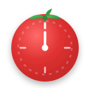

# 🍅 Addereums Pomodoro – Fokus- & Produktivitäts-Timer

[](https://github.com/addereum/pomodoro-app/releases)
[](https://opensource.org/licenses/MIT)

Eine schlanke, robuste und moderne Pomodoro-App von [addereum](https://github.com/addereum), entwickelt für **Linux (Fedora, Ubuntu, Debian, Arch)** und **Windows 10/11**.

Repository: [https://github.com/addereum/pomodoro-app](https://github.com/addereum/pomodoro-app)



---

> [!IMPORTANT]
> ### 🐧 Entwickelt für Linux First!
> **Addereums Pomodoro** wurde von Grund auf nach **„Linux First“**-Prinzipien für moderne Linux-Desktops (Wayland, GNOME, GTK4 & Libadwaita) entwickelt.
>
> **Unterstützte & getestete Distributionen:**
> - 🎩 **Fedora Linux** (Workstation, Silverblue)
> - 🟠 **Ubuntu** & **Debian**
> - 🟢 **Linux Mint** & **Pop!_OS**
> - 🔵 **Arch Linux** & **Manjaro**
> - 🦎 **openSUSE** (Tumbleweed / Leap)
> - 🏢 **RHEL** / CentOS Stream / Rocky Linux / AlmaLinux
> - 📦 Beliebige Linux-Distributionen via **Universal Portable Tarball** oder `./installers/install-linux.sh`
>
> ---
>
> ### 🪟 Hinweis zu Windows
> Neben der Linux-Hauptversion stellen wir auch fertige Windows-Pakete (`Setup.exe`, `Pomodoro.exe` und `.zip`) bereit. Da der Entwicklungsfokus primär auf Linux liegt, können unter Windows gelegentlich kleinere Fehler oder Abweichungen auftreten.
>
> **Fehler gefunden oder Verbesserungsideen?**
> - Bitte gerne einen Fehlerbericht unter [GitHub Issues](https://github.com/addereum/pomodoro-app/issues) melden!
> - Oder noch besser: **Projekt forken, Problem beheben (fixen), testen und einen Pull Request (PR) öffnen!** Community-Beiträge sind jederzeit sehr willkommen! ❤️

---

## ✨ Features

1. **Präzise, driftfreie Timer-Logik**
   - Zeitstempel-basierte Zeitmessung (kein Drift bei Hintergrundausführung oder Standby).
   - Saubere Intervall-Wechsel: **Fokus** (25 min) ➔ **Kurze Pause** (5 min) ➔ **Lange Pause** (15 min nach 4 Runden).
   - Große, flüssig animierte kreisförmige SVG-Fortschrittsanzeige.

2. **Native Fedora / GNOME Integration**
   - **GTK4 & Libadwaita Headerbar**: Integriert sich nahtlos in die GNOME-Desktop-Umgebung.
   - **System-Tray & AppIndicator**: Läuft auf Wunsch minimiert im Panel mit Live-Countdown und Schnellsteuerung (*Fenster zeigen, Pause, Überspringen, Beenden*).
     > 💡 *Hinweis für GNOME:* GNOME Shell hat standardmäßig keine Tray-Symbole im oberen Panel. Installiere einfach `sudo dnf install gnome-shell-extension-appindicator` (Fedora) bzw. `sudo apt install gnome-shell-extension-appindicator` (Ubuntu), um Status-Icons in der oberen Leiste zu aktivieren.
   - **🔕 Automatischer Nicht-Stören-Modus (DND)**: Schaltet Benachrichtigungs-Popups während aktiver Fokus-Zeiten automatisch stumm und stellt sie danach wieder her.
   - **📋 Standup (MD) Export**: Kopiert einen formatierten Markdown-Tagesbericht für Standups oder GitHub PRs in die Zwischenablage.
   - **Native System-Benachrichtigungen**: Nutzt `notify-send` / Freedesktop-Notifications inklusive App-Icon bei Intervallende.
   - **Automatischer Dark/Light Theme Sync**: Passt sich automatisch dem systemweiten GNOME-Erscheinungsbild an.
   - **Titel-Aktualisierung**: Verbleibende Restzeit direkt in der Fensterleiste sichtbar (`(24:59) Fokus - Addereums Pomodoro`).

3. **Audio-Feedback & Ambient Fokus-Sound (Web Audio API)**
   - **Signal-Töne**: *Tibetische Klangschale (Zen Gong)*, *Kristall-Chime*, *Digitaler Doppel-Beep* oder *Stumm*.
   - **🎧 Prozedurale Ambient-Fokusgeräusche**: Sanfter Regen, Meeresrauschen oder Braunes Rauschen (Deep Focus) laufen während der Fokus-Session und pausieren automatisch während der Pausen.

4. **Kompakt- & Widget-Modus („Mini-Player“)**
   - Ein Klick auf das Fenster-Icon im Header schrumpft die App auf ein horizontales Mini-Overlay (320 × 140 px) mit Countdown und Schnellsteuerung.
   - Ideal, um es während des Codens oder Schreibens in der Bildschirmecke geöffnet zu lassen.

5. **Spontane Verlängerung (`+5 Min.`)**
   - Mitten im Flow? Ein Klick auf `+5m` verlängert die laufende Session um 5 Minuten, ohne den Timer zu unterbrechen.

6. **Tagesziel & Fortschrittsbalken**
   - Einstellbares Pomodoro-Tagesziel (z. B. 6 Pomodoros) mit dynamischem Fortschrittsbalken direkt auf der Startseite.

7. **Session-Notizen & CSV-/JSON-Export**
   - Nach jedem Fokus-Block kann optional eine kurze Notiz (*„Refactoring abgeschlossen“*) hinterlegt werden.
   - Alle Sessions können im Statistik-Tab per Klick als **CSV** oder **JSON** exportiert werden (perfekt für Stundenzettel oder Git-Logs).

8. **Mini-Task- & To-Do-Liste**
   - Aufgaben mit geschätzten Pomodoros erstellen (z. B. *"Bugfix #42 [2 Pomodoros]"*).
   - **Fokus-Ziel verknüpfen**: Klicke auf eine Aufgabe, um sie als aktive Aufgabe zu setzen. Sie wird prominent im Timer angezeigt.
   - Bei Abschluss einer Fokus-Runde wird der Pomodoro-Zähler der aktiven Aufgabe automatisch um 1 erhöht.
   - Aufgaben als erledigt abhaken, filtern (Alle / Offen / Erledigt) und bereinigen.

9. **Statistik & Produktivitäts-Tracking**
   - Heutige absolvierte Pomodoros und gesamte Fokuszeit in Stunden/Minuten.
   - **Streak-Tracker**: Zählt die aufeinanderfolgenden Tage, an denen du produktiv warst.
   - **7-Tage-Balkendiagramm**: Zeigt die Pomodoro-Verteilung der letzten 7 Tage visualisiert an.
   - **Session-Verlauf**: Chronologische Liste mit Aufgabenbezug und Session-Notizen.

10. **Konfigurierbare Einstellungen**
    - Fokus-Dauer (1–90 Min.), Kurze Pause (1–30 Min.), Lange Pause (1–60 Min.), Tagesziel.
    - Rundenanzahl bis zur langen Pause (1–10).
    - **Auto-Start**: Pausen automatisch starten und/oder nächsten Fokus-Block automatisch starten.
    - Standardwerte-Reset per Klick.

11. **Tastaturkürzel für maximale Produktivität**
   - <kbd>Leertaste</kbd>: Start / Pause
   - <kbd>R</kbd>: Timer zurücksetzen
   - <kbd>S</kbd>: Aktuelle Phase überspringen
   - <kbd>1</kbd> / <kbd>2</kbd> / <kbd>3</kbd> / <kbd>4</kbd>: Zwischen Tabs wechseln (Timer, Aufgaben, Statistik, Optionen)
   - <kbd>F</kbd>: Direkt zu Fokus-Phase wechseln
   - <kbd>K</kbd>: Direkt zu Kurze Pause wechseln
   - <kbd>L</kbd>: Direkt zu Lange Pause wechseln

---

## 🚀 Schnellstart

### 1. Als native Desktop-App starten (Empfohlen für Fedora)
```bash
./run.sh
# oder kurz:
./pomodoro
```

### 2. In Fedora / GNOME Dash installieren
Führe einmalig folgenden Befehl aus, um Pomodoro dauerhaft in deinem Anwendungsmenü mit Icon zu registrieren:
```bash
./run.sh --install
```
*Danach kannst du die App einfach über die `Super`-Taste / GNOME-Suche nach **"Pomodoro"** öffnen.*

### 3. Im Web-Browser starten (Optional)
Falls du die App lieber direkt in Firefox oder Chrome im Browser nutzen möchtest:
```bash
./run.sh --web
```

---

## 📦 Distribution & Installer (`installers/`)

Fertig gebaute Pakete befinden sich in [`installers/dist/`](file:///home/lukas/Apps/pomodoro-app/installers/dist) bzw. auf der [GitHub Releases-Seite](https://github.com/addereum/pomodoro-app/releases):

- **Ubuntu / Debian / Pop!_OS / Mint (.deb):** `sudo apt install ./installers/dist/pomodoro-app_1.0.0_all.deb`
- **Fedora / RHEL / CentOS / openSUSE (.rpm):** `sudo dnf install ./installers/dist/pomodoro-app-1.0.0-*.rpm`
- **Universal Linux Portable:** `installers/dist/pomodoro-app-1.0.0-linux-x86_64-portable.tar.gz`
- **Universal Shell-Installer:** `./installers/install-linux.sh` (benutzerweit ohne Root oder systemweit mit Sudo)
- **Windows 10 / 11:** `installers/dist/pomodoro-app-1.0.0-windows-x64.zip` bzw. `Addereums-Pomodoro-Setup.exe`

Alle Details und Skripte findest du im [Installers README](file:///home/lukas/Apps/pomodoro-app/installers/README.md).

---

## 📁 Projektstruktur

```
pomodoro-app/
├── run.sh                  # Zentraler Starter (Desktop, Web, Install)
├── pomodoro                # Symlink auf run.sh
├── pomodoro.desktop        # Fedora / GNOME Desktop-Starter
├── README.md               # Dokumentation
└── app/
    ├── main.py             # Nativer GTK4 / Libadwaita / WebKitGTK-Host
    ├── icon.svg            # Vektorbasiertes App-Icon
    └── web/
        ├── index.html      # UI-Struktur & Tabs
        ├── css/
        │   └── style.css   # Adwaita Dark/Light Theme & UI-Styles
        └── js/
            ├── app.js      # Hauptcontroller & Ereignisverbindung
            ├── timer.js    # Driftfreie, präzise Timer-Engine
            ├── audio.js    # Web Audio API Klangsynthesizer
            ├── tasks.js    # Aufgaben- & To-Do-Verwaltung
            ├── stats.js    # Statistik, Streak- & Diagramm-Berechnung
            ├── settings.js # Benutzer-Einstellungen & Persistenz
            └── bridge.js   # Native Desktop- & Benachrichtigungs-Bridge
```

---

## 🛠️ Technische Details
- **Frontend**: Zero-Dependency JavaScript (ES Modules), CSS3 mit CSS Custom Properties, SVG & HTML5.
- **Desktop-Host**: Python 3 mit PyGObject (`Gtk 4.0`, `Adw 1`, `WebKit 6.0`).
- **Benachrichtigungen**: Native Freedesktop Notifications via `notify-send` / `Gio.Notification`.
- **Audio**: Web Audio API (keine externen MP3-Dateien oder Netzwerk-Downloads erforderlich).
